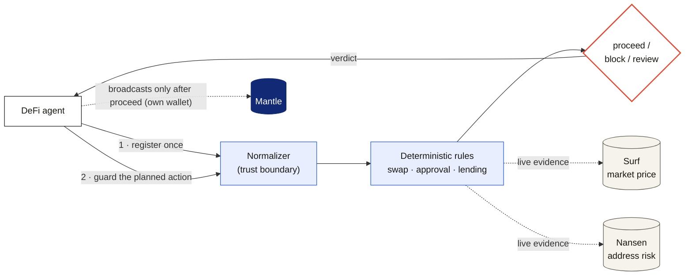

<p align="center">
  <picture>
    <source media="(prefers-color-scheme: dark)" srcset="docs/assets/rinne-logo-dark.png">
    
  </picture>
</p>

<p align="center"><strong>A pre-execution safety guard for autonomous DeFi agents on Mantle.</strong></p>

<p align="center">
  <a href="https://rinne.timidan.xyz/app"><b>Live dashboard</b></a> &nbsp;·&nbsp;
  <a href="https://rinne.timidan.xyz/skill.md">Agent skill</a> &nbsp;·&nbsp;
  <a href="https://sepolia.mantlescan.xyz/address/0xD6C9Bc635CaB482717B3aABB8842e2D1E762a05b">Mantle Sepolia contract</a>
</p>

<p align="center">
  
  
  
</p>

---

Before an autonomous agent swaps, approves, or borrows on Mantle, it asks Rinne —
and gets back `proceed`, `block`, or `review`, backed by deterministic rules and
live market + risk evidence. Rinne **never executes transactions and never takes
a private key**; the agent broadcasts its own transaction after Rinne approves.
Agents integrate voluntarily and obey `block`.

Mantle is a high-performance Ethereum L2, and agents transacting there need a
guardrail that catches a catastrophic trade *before* it is signed — a zero-floor
swap, an unlimited approval, a borrow into liquidation range. That is Rinne.



### ▶ Try it live

The guard is deployed at **https://rinne.timidan.xyz** — open the
[dashboard](https://rinne.timidan.xyz/app), or onboard an agent with one call:

```sh
curl https://rinne.timidan.xyz/skill.md     # returns the full register-then-guard contract
```

## The proceed / block / review model

Every guard call returns a `GuardDecision` with one of three gates:

- **`proceed`** — no critical rule failed. Act if your own policy also agrees.
- **`block`** — a CRITICAL rule failed. Do not execute.
- **`review`** — something could not be verified (a provider was unreachable) or
  a soft limit was crossed. Pause for human review.

Gate logic, in order: any critical rule fail → `block`; otherwise any warning
fail **or** any provider status `error` → `review`; otherwise `proceed`. The
posture is conservative: when Rinne cannot positively verify a counterparty or a
figure, it returns `review` rather than `proceed`. A `review` means "we could
not be sure", never "we guessed".

## How an agent integrates (~30 seconds)

No UI is needed. The whole contract is three calls:

```sh
# 1. Install the skill — returns the register-then-guard contract
#    with this instance's base URL already substituted in.
curl https://rinne.timidan.xyz/skill.md
```

```sh
# 2. Self-register (open, no auth) → returns an agent id and an API key
#    "rinne_live_..." shown exactly once.
curl -X POST https://rinne.timidan.xyz/v1/register-agent \
  -H 'Content-Type: application/json' \
  -d '{ "name": "my-agent" }'
```

```sh
# 3. Before acting, guard the planned action with your key.
curl -X POST https://rinne.timidan.xyz/v1/guard \
  -H 'Authorization: Bearer rinne_live_...' \
  -H 'Content-Type: application/json' \
  -d '{ "action": { "kind": "swap", "chain": "mantle", ... } }'
```

The skill source is [docs/agents/SKILL.md](docs/agents/SKILL.md), served at
`/skill.md` with the real base URL filled in.

## Action families and chains

Three action families today:

| Family | What it guards |
| --- | --- |
| `swap` | A token swap: floor (`min-received`), slippage, quote freshness, market evidence. |
| `approval` | An ERC-20 approval: no unlimited allowance, amount limit, spender risk. |
| `lending` | A borrow/lend action: resulting health factor and protocol risk. |

Two chains: **`mantle`** (mainnet, chainId 5000) and **`mantle-sepolia`**
(testnet, chainId 5003).

### Rules

| Rule | Severity | Behavior |
| --- | --- | --- |
| `swap-min-received-required` | critical | No floor, or a zero floor, is blocked. |
| `swap-slippage-limit` | critical | Slippage above 300 bps is blocked; no cap **and** no `expectedOut` → review. |
| `swap-floor-consistency` | critical | A floor below what `expectedOut` + slippage implies (an economically meaningless floor) is blocked. |
| `swap-quote-freshness` | warning | A quote older than 120s — or dated in the future — → review. |
| `swap-market-evidence` | warning | Surf unavailable → review. |
| `approval-no-unlimited` | critical | Unlimited / absurd allowance is blocked. |
| `approval-amount-limit` | warning | Amount above the operator threshold → review. |
| `approval-spender-risk` | — | Nansen high-risk → block; allowlisted → proceed; unrecognized or unverifiable → review. |
| `lending-health-factor-present` | warning | Missing resulting health factor → review. |
| `lending-health-factor-min` | critical | Resulting HF below 1.25 is blocked. |
| `lending-health-factor-consistency` | warning | A declared HF that *rises* on a borrow/withdraw (contradictory) → review. |
| `lending-protocol-risk` | — | Same posture as spender risk: high-risk → block; allowlisted → proceed; unrecognized → review. |

### Live evidence — no mocks, ever

The block path is pure rule math (a swap with no floor, an unlimited approval, a
borrow below a 1.25 health factor), so it never depends on a provider being up.
Two live providers sharpen decisions:

- **Surf** — market price (`GET api.asksurf.ai/gateway/v1/market/price`,
  `Authorization: Bearer`), used for swaps.
- **Nansen** — address risk labels
  (`POST api.nansen.ai/api/v1/profiler/address/labels`, header `apikey`), used
  for approval/lending spender and protocol risk.

A provider that fails is recorded and pushes the gate to `review` — Rinne never
substitutes canned data.

## Local quickstart

Requires Node.js 20+ and pnpm.

```sh
pnpm install
pnpm --filter rinne-web build              # build the dashboard
pnpm --filter rinne build                  # compile the engine + CLI
node rinne/dist/src/cli/index.js serve      # serve guard API + skill + dashboard
```

The single service serves the guard API (`/v1`, `/api`), the agent skill
(`/skill.md`), and the observe-only dashboard (`/app`) on one origin. Check
readiness — including live Surf reachability — with:

```sh
node rinne/dist/src/cli/index.js doctor
```

The CLI has exactly two commands: **`serve`** and **`doctor`**.

Set `SURF_API_KEY` and `NANSEN_API_KEY` for the full live path. Set
`RINNE_HOSTED=1` to require both keys at startup.

## Dashboard

The dashboard (rinne-web; React, Vite, Tailwind) is served at `/app`. It is
**observe-only**: it lists registered agents and their decisions. Registration
is always agent-initiated over `/v1` — never through the UI.

## Storage and security

State is a file-backed store at `rinne/artifacts/store/{agents,decisions}.json`
— no database. API keys are stored only as **hashes**; secrets are never logged
or returned. The plaintext key is shown once, at registration.

## What Rinne does not do

- It never executes transactions and never takes a private key.
- It does not stop arbitrary bots — agents integrate voluntarily and obey
  `block`.
- It never substitutes canned data for a failed provider.
- Guard decisions are **not yet anchored on-chain per decision**. The anchoring
  contract is deployed and verifiable (see below), but the guard does not emit a
  `GuardDecisionAnchored` event per decision yet — that is deliberately kept off
  the hot path so the chain's latency/uptime can never affect a guard answer.

## Repo layout

```
rinne/            engine + CLI + server (TypeScript, Node built-ins, strict ESM)
  src/guard/      action normalize, rule registry, evaluate, guard service
  src/providers/  live Surf + Nansen evidence + risk signal
  src/core/       guard types, store, api-keys, decimal, ids
  src/server/     the single hosted service (/v1, /api, /skill.md, /app)
  src/cli/        serve + doctor
  src/adapters/   surf payload normalize
  artifacts/      file-backed store (gitignored)
rinne-web/        observe-only dashboard (React, Vite, Tailwind)
rinne-contracts/  Foundry/Solidity; RinneAgentRegistry deployed on Mantle Sepolia
examples/         runnable zero-dependency agent example
docs/             architecture, ADRs, agents/SKILL.md; CONTEXT.md defines terms
```

## On-chain (Mantle Sepolia)

The anchoring contract is **deployed and verifiable** on Mantle Sepolia:

| | |
| --- | --- |
| `RinneAgentRegistry` | [`0xD6C9Bc635CaB482717B3aABB8842e2D1E762a05b`](https://sepolia.mantlescan.xyz/address/0xD6C9Bc635CaB482717B3aABB8842e2D1E762a05b) |

It is **event-only**: `anchorGuardDecision` emits a `GuardDecisionAnchored`
event carrying only a decision hash, an agent id, the gate, and an opaque report
URI — never endpoint URLs, API keys, or raw action data. The guard runs fully
without it; wiring the server to emit per decision (writing the tx hash into
`GuardDecision.onchain`) is the next step, kept asynchronous and best-effort by
design. Source: [rinne-contracts/src/RinneAgentRegistry.sol](rinne-contracts/src/RinneAgentRegistry.sol);
deployment record: [rinne-contracts/deployments/mantle-sepolia.json](rinne-contracts/deployments/mantle-sepolia.json).

## Security

Rinne's safety properties are pinned by a regression suite: the guard never lets
a zero-floor swap, an unlimited approval, or a sub-1.25 health factor reach
`proceed`, and a failed provider always degrades to `review` — never canned
data. The codebase went through an adversarial security review; findings on
floor integrity, self-attested figures, provider fail-open, open-registration
abuse/rate-limiting, and error hygiene were fixed before deploy. API keys are
stored only as SHA-256 hashes and compared in constant time.

A runnable example agent lives in
[examples/guard-a-swap.mjs](examples/guard-a-swap.mjs):

```sh
node examples/guard-a-swap.mjs   # registers an agent, guards a sound swap (proceed) + a zero-floor swap (block)
```

## Production

In production the Node process runs behind nginx (TLS) and systemd on a single
origin. See [DEPLOY.md](DEPLOY.md) for the droplet runbook.

## More

- [docs/agents/SKILL.md](docs/agents/SKILL.md) — the agent integration skill.
- [docs/rinne-architecture.md](docs/rinne-architecture.md) — the full plan.
- [CONTEXT.md](CONTEXT.md) — product language and terms.
