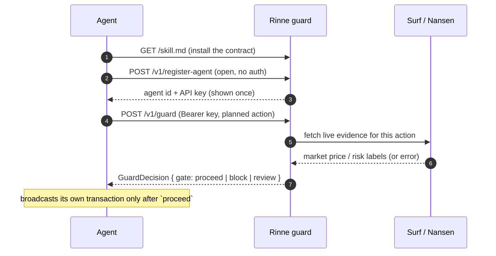
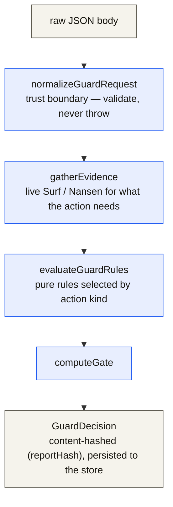
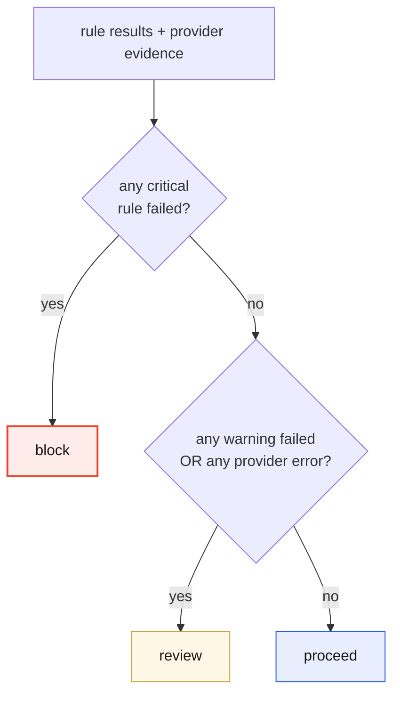
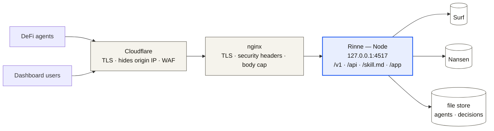

<p align="center">
  <picture>
    <source media="(prefers-color-scheme: dark)" srcset="assets/rinne-logo-dark.png">
    
  </picture>
</p>

# Rinne Architecture

Rinne is a hosted DeFi agent guard for Mantle. An autonomous agent describes a
DeFi action it is about to take — a swap, an approval, or a lending operation —
and Rinne returns a deterministic decision: `proceed`, `block`, or `review`.
The agent broadcasts its own transaction with its own wallet, but only after
Rinne approves.

The goal is to put a verifiable safety gate in front of agent-initiated
transactions before they touch Mantle. Every decision is backed by live
external evidence (Surf market data, Nansen address labels) and a set of pure,
inspectable rules, then recorded so it can be re-derived and audited.

> This document describes the hosted guard. An earlier version of Rinne was an
> offline testing tool; that system has been removed. Today Rinne is purely a
> request-time guard that agents call before acting; the CLI is `serve` and
> `doctor`.

## What Rinne is and is not

- Rinne **never executes transactions** and **never takes a private key**. It
  judges a described action and returns a decision; the agent acts on its own.
- Rinne **never substitutes canned data** for a failed provider. If Surf or
  Nansen cannot be reached, the affected decision becomes `review`, never a
  fabricated `proceed`.
- Rinne issues decisions only for three action families today — **swap**,
  **approval**, **lending** — on two chains: `mantle` (mainnet, chainId 5000)
  and `mantle-sepolia` (testnet, chainId 5003).

## Core constraint: fail toward review, never toward proceed

`block` and `review` are both safe outcomes; the only dangerous outcome is a
wrong `proceed`. The rule engine is therefore conservative — when it cannot
positively verify a counterparty or a figure, it returns `review` rather than
`proceed`. An unrecognized spender or protocol (one that is neither
operator-allowlisted nor positively labeled) is sent to review, because the
absence of a risk label is not proof of safety: a brand-new malicious contract
simply has no labels yet. `review` means "a human should look", never "we
guessed".

## Request flow

A complete integration is three steps, all over HTTP with JSON, no SDK
required.



Inside step 3, one guard call runs end to end — a single pure pipeline:



The orchestration lives in `runGuard` (`guard/guard-service.ts`): it gathers
evidence, evaluates rules, assembles a `GuardDecision` with a `reportHash` over
the exact inputs that produced the gate, and saves it. The decision is also
returned to the caller.

## The normalizer: the trust boundary

`normalizeGuardRequest` (`guard/normalize-action.ts`) is the single boundary
between untrusted agent-supplied JSON and the rest of the engine. Everything
downstream may assume the typed shapes in `core/guard-types.ts` without
re-checking. Its contract:

- **Throw-free.** A guard that crashes on a malformed body is itself a hazard.
  Every failure becomes `{ ok: false, problem, raw }`, where `problem` names
  the offending field and what was expected, so an agent can fix its payload
  from the message alone. Internally, field checks raise a private
  `ValidationProblem` that a single `try/catch` converts to a result; nothing
  else escapes.
- **Lenient in, strict out.** Unknown extra fields are silently dropped (agents
  may over-send without breaking), but every field that is kept is validated,
  and the normalized output contains only schema-defined fields.
- **Loud on bugs.** Amounts must be plain decimal strings (no `1e18`, signs, or
  separators); addresses must be exactly `0x` + 40 hex; basis points must be an
  integer in `[0, 9999]` (10000 bps = 100% is treated as a unit-confusion bug);
  the chain must be `mantle` or `mantle-sepolia`, carried per-action so the
  decision records the real chain. Spenders and lending protocols may be a
  well-known name (e.g. `"lendle"`) during early integration, but anything
  starting with `0x` must be a complete, valid address — a truncated address
  must not pass silently as a "name" and skip the address-keyed risk checks.

`metadata` is an open record by contract and passes through shallow-copied;
`context` (walletAddress / dryRun / note) is type-checked but optional.

## The rule engine

Rules are pure functions of a `GuardRuleContext` (`action`, `evidence`,
`allowlists`, injected `now`). The same inputs always produce the same result,
which is what makes a recorded decision auditable later. `evaluateGuardRules`
(`guard/evaluate.ts`) selects the rules whose `appliesTo` matches the action
kind, runs them, and derives the gate and a human summary from the results.

Each rule returns a `GuardRuleResult` with a `status`
(`pass` / `fail` / `not-applicable`), a `severity` (`info` / `warning` /
`critical`), a human `explanation`, and structured `evidence`.

### Swap rules (`guard/rules/swap.ts`)

| Rule | Severity | Fails when |
|---|---|---|
| `swap-min-received-required` | critical | no `minReceived` floor is declared, or it is ≤ 0 |
| `swap-slippage-limit` | critical / warning | `maxSlippageBps` > 300 (critical); neither a cap nor `expectedOut` declared (warning → review) |
| `swap-floor-consistency` | critical | `minReceived` is below the minimum implied by `expectedOut` at the declared slippage — an economically meaningless floor |
| `swap-quote-freshness` | warning | quote timestamp is unparseable, older than 120s, or dated in the future |
| `swap-market-evidence` | warning | Surf market evidence is unavailable (status `error`) |

The hard gates are pure action math — a positive floor, a floor consistent with
the expected output, and a sane slippage cap — so a dangerous swap blocks even
when Surf is unreachable. The market-evidence rule turns a Surf failure into a
review signal; it never invents a price.

### Approval rules (`guard/rules/approval.ts`)

| Rule | Severity | Fails when |
|---|---|---|
| `approval-no-unlimited` | critical | allowance is the max-uint sentinel or an effectively unlimited magnitude |
| `approval-amount-limit` | warning | amount exceeds the operator's display threshold for the token |
| `approval-spender-risk` | critical / warning | Nansen flags the spender high-risk (critical → block); the spender is unreachable, unrecognized, or unallowlisted (warning → review) |

`approval-spender-risk` is conservative: an explicit high-risk label blocks; an
operator-allowlisted spender short-circuits to pass; everything else — a
provider error, **or** an unrecognized spender with no positive trust signal —
is sent to review. The absence of a risk label is not treated as proof of
safety (the Nansen evidence, if any, is still recorded on the decision).

### Lending rules (`guard/rules/lending.ts`)

| Rule | Severity | Fails when |
|---|---|---|
| `lending-health-factor-present` | warning | a risk-increasing op (borrow/withdraw) declares no `healthFactorAfter` |
| `lending-health-factor-min` | critical | resulting health factor < 1.25 |
| `lending-health-factor-consistency` | warning | on a borrow/withdraw, the declared resulting health factor is **not lower** than the prior one (contradictory) |
| `lending-protocol-risk` | critical / warning | same conservative posture as `approval-spender-risk`, for the protocol |

The health-factor floor is compared with exact fixed-point arithmetic (scale
18), truncating excess precision toward zero so a value crafted just under the
floor (e.g. `1.2499999999999999`) cannot round up past the block; an
unparseable value is treated as below the floor (block), never above it.

Health-factor figures are **agent-attested**: Rinne checks the agent's declared
post-action state against the floor and for internal consistency (a borrow must
lower the factor), which catches both miscalculation and contradictory
declarations. Independently recomputing the position on-chain is future work —
until then a borrow/withdraw with no declared `healthFactorAfter` is reviewed,
never proceeded.

### Operator policy: allowlists

Allowlists are operator policy verified out-of-band, loaded by `loadAllowlists`
from `config/guard-allowlists.json` (overridable via `RINNE_GUARD_CONFIG`). A
missing file is a valid state — the guard runs with empty policy, and unknown
spenders/protocols simply do not get the allowlist fast-path. A file that
exists but cannot be read or parsed is a configuration bug and throws.

An entry matches **only by on-chain address** (case-insensitive). Matching by
name is deliberately disallowed: the allowlist skips the live risk provider, so
granting that skip on a free-text label an agent supplies would let an
unverified address ride a trusted name to `proceed`. Config normalization is
lenient — malformed entries are dropped, and an unparseable approval threshold
falls back to the built-in default (`1000000`) rather than disabling the
amount rule (which would fail open on an operator typo).

### Gate computation (`computeGate` in `guard/rules.ts`)



A critical failure is a hard stop. A warning failure means a human should look
before funds move. A provider error means the guard could not see what it
normally sees, so the action goes to `review` rather than proceeding blind —
even when every rule that could run passed.

## The provider layer

Evidence is gathered per action by `gatherEvidence` and is always one of two
honest states: `live` (a real provider answered; the raw payload hash is
recorded) or `error` (the provider failed; the failure string is recorded).
There is no mock state and no canned fallback (`providers/provider-evidence.ts`).

- **Surf (live)** — `providers/surf-live.ts`. For swaps, fetches market price
  for `tokenIn` via `GET {SURF_API_URL}/v1/market/price?symbol=…&time_range=1d`
  (default base `https://api.asksurf.ai/gateway`, `Authorization: Bearer
  $SURF_API_KEY` when set). The raw payload is normalized by
  `normalizeMarketPayload` (`adapters/surf.ts`) into a price, an observation
  timestamp, and a confidence derived deterministically from data freshness.
  A network failure, or a payload that does not match the documented shape,
  returns `error` evidence.
- **Nansen (live)** — `providers/nansen-live.ts`. For approvals and lending,
  fetches address risk **labels** for the spender/protocol via `POST
  {NANSEN_API_URL}/profiler/address/labels` (default base
  `https://api.nansen.ai/api/v1`, header `apikey: $NANSEN_API_KEY`, body
  `{ address, chain, pagination }`). Nansen exposes risk as labels, not a
  numeric score. A missing key, a non-address reference (names cannot be looked
  up), or a failed fetch returns `error` evidence — never canned labels.

A single shared definition of "high risk" (`providers/risk-signal.ts`,
`detectHighRiskLabel`) matches whole-word danger phrases (malicious, scam,
exploiter, drainer, sanctioned, rug-pull, blacklisted, …) against the labels,
so the Nansen adapter and the approval/lending rules cannot drift on what
counts as dangerous.

When a referenced spender or protocol is operator-allowlisted, `gatherEvidence`
skips the provider entirely: the operator already verified it, and an
unreachable provider would only add a failure mode that pushed an
already-verified action to `review`.

## The file-backed store

`createGuardStore(rootDir)` (`core/guard-store.ts`) persists two plain JSON
files under `rinne/artifacts/store/`:

- `agents.json` — registered agents.
- `decisions.json` — every `GuardDecision` issued, newest first.

Plain JSON keeps the hosted MVP inspectable with nothing but `cat`. Writes use
write-to-temp-then-rename so a crash mid-write never leaves a truncated file,
and all operations run through an in-process promise-chain mutex so a read can
never observe a half-finished read-modify-write. A missing file means "nothing
stored yet" (empty array); unreadable, corrupt, or wrong-shaped files are
surfaced loudly rather than silently dropping records.

### API keys are hashed, never stored in the clear

API key lifecycle lives in `core/api-keys.ts`. A key is
`rinne_live_` + 192 bits of random hex. Only its SHA-256 hash is persisted on
the agent record (`apiKeyHash`); the plaintext leaves the system exactly once,
in the return value of `createAgent`, and is never written to disk, decisions,
or logs. Verification recomputes the hash from the presented key and compares
with `timingSafeEqual` (constant-time). `findAgentByApiKey` is a pure
composition over `listAgents` + `verifyApiKey`, so the store interface stays
plain CRUD. A lost key means re-registering.

## The single-origin server

`startServer` (`server/index.ts`) runs everything on one HTTP origin (default
port 4517, bound to `127.0.0.1`). `rinne serve` is the only command that starts
it.

### Agent-facing `/v1` (the guard API)

| Route | Auth | Purpose |
|---|---|---|
| `POST /v1/register-agent` | none | self-register; returns the agent view and a one-time API key |
| `POST /v1/guard` | Bearer (agent key) | normalize, evaluate, return and persist a `GuardDecision` |
| `POST /v1/agents/:id/rotate-key` | Bearer (current key) | rotate the agent's own key; the old key is invalidated |
| `GET /v1/agents/:id` | public | agent view + its decisions (no secret in the response) |
| `GET /v1/decisions/:id` | public | one decision |

Registration is **agent-initiated** and requires no operator credential. A
guard call's Bearer key must match the `agentId` in the body, so one agent
cannot file decisions as another. On a successful guard call the agent's
`lastSeenAt` is updated so the dashboard can show it as active.

### Dashboard `/api` (observe-only reads)

`GET /api/agents`, `GET /api/decisions` (optional `?agentId=`),
`GET /api/agents/:id`, `GET /api/decisions/:id`, and `GET /api/doctor`. These
are public observation reads; the dashboard never registers or mutates agents.
Agent views are built by `buildAgentView`, which strips the API key hash and
adds a derived status (`healthy` / `quiet` / `offline`, from recency of
`lastSeenAt`) and decision counters.

### Skill and dashboard

- `GET /skill.md` (and `/skill`) serves `docs/agents/SKILL.md` as raw markdown,
  substituting `$RINNE_BASE_URL` with this instance's origin (honouring
  `X-Forwarded-Proto` behind a proxy) so every `curl` example is copy-paste
  ready. This is how an agent "installs" Rinne in one request.
- Any other `GET` serves the built `rinne-web` dashboard (React / Vite /
  Tailwind) with SPA fallback. The dashboard lives at `/app` and is
  observe-only: it lists registered agents and their decisions. Registration is
  never done through the UI.

### Origin and body protections

CORS allows loopback origins, same-origin requests (so the dashboard works on
any deployed domain with no per-domain config), and any extra origins listed in
`RINNE_ALLOWED_ORIGINS`. Request bodies are capped at 64 KiB. Path parameters
must match a safe-id pattern.

### Hosted mode

With `RINNE_HOSTED=1` the server refuses to start unless `SURF_API_KEY` and
`NANSEN_API_KEY` are present, rather than silently degrading to error-only
evidence. Local development (the default) runs without them; guard calls then
surface provider errors as `review` decisions, which is the honest local
behavior.

## Deployment shape

The production shape is this one Node process behind an nginx reverse proxy on
the same host, supervised by systemd, and fronted by Cloudflare. A live
instance runs at `https://rinne.timidan.xyz`. See `DEPLOY.md` for the full
droplet runbook; the `deploy/` directory ships the templates.



- **systemd** (`deploy/rinne.service`): runs
  `node dist/src/cli/index.js serve` as a dedicated `rinne` user, with an
  `EnvironmentFile` at `/etc/rinne.env`. The unit is hardened — `ProtectSystem=strict`,
  `ProtectHome`, `PrivateTmp`, `NoNewPrivileges` — and the only writable path is
  the file store at `/opt/rinne/rinne/artifacts`.
- **nginx** (`deploy/nginx-rinne.conf`): terminates TLS (Let's Encrypt /
  certbot), proxies all paths to `127.0.0.1:4517`, caps request bodies, and
  forwards `X-Forwarded-Proto` so the served skill emits `https://` URLs and
  same-origin CORS keeps working.

## On-chain anchoring (Mantle Sepolia)

`GuardDecision` carries an optional `onchain` field
(`{ chainId, txHash?, registryAddress? }`) in `core/guard-types.ts`. The
anchoring contract, `RinneAgentRegistry`, is **deployed and verifiable** on
Mantle Sepolia at
[`0xD6C9Bc635CaB482717B3aABB8842e2D1E762a05b`](https://sepolia.mantlescan.xyz/address/0xD6C9Bc635CaB482717B3aABB8842e2D1E762a05b)
(`rinne-contracts/`, deployment record in
`rinne-contracts/deployments/mantle-sepolia.json`). It is **event-only**:
`anchorGuardDecision` emits a `GuardDecisionAnchored` event carrying only a
decision hash, an agent id, the gate, and an opaque report URI — never endpoint
URLs, API keys, or raw action data.

What is **not** wired yet: `runGuard` does not populate `onchain` per decision —
the guard does not send an anchoring transaction on the request hot path. That
is deliberate. Anchoring must be asynchronous and best-effort so the chain's
latency or uptime can never affect, or delay, a guard answer; the contract and
the type hook are ready for that async emit, which is the next step.

## Module map

```text
rinne/src/
  guard/
    normalize-action.ts   trust boundary: untrusted JSON -> typed GuardRequest
    guard-service.ts       runGuard, gatherEvidence, buildAgentView, status
    evaluate.ts            select + run rules, derive gate and summary
    rules.ts               GuardRule type, allowlists, computeGate
    rules/{swap,approval,lending}.ts   the rule sets
  providers/
    surf-live.ts           live Surf market evidence
    nansen-live.ts         live Nansen address-label evidence
    risk-signal.ts         shared high-risk label detection
    provider-evidence.ts   live/error evidence builders + bounded fetch
  core/
    guard-types.ts         public JSON shapes (agents, actions, decisions)
    guard-store.ts          file-backed store + findAgentByApiKey
    api-keys.ts             create / hash / verify (constant-time)
    decimal.ts, ids.ts      fixed-point math, id + hash helpers
  server/index.ts          single-origin server (/v1, /api, /skill.md, dashboard)
  cli/
    index.ts               only two commands: serve, doctor
    commands/{serve,doctor}.ts
  adapters/
    surf.ts                normalizeMarketPayload + surfApiBase
```

`rinne doctor` checks Node ≥ 20, pnpm, Surf Data API reachability, and guard
store writability — the readiness probe for running the server, also exposed at
`GET /api/doctor`.
